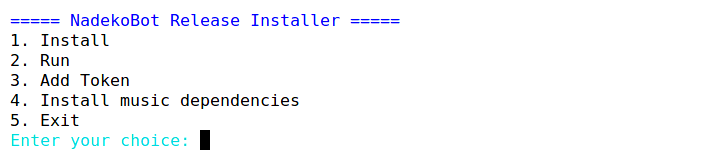
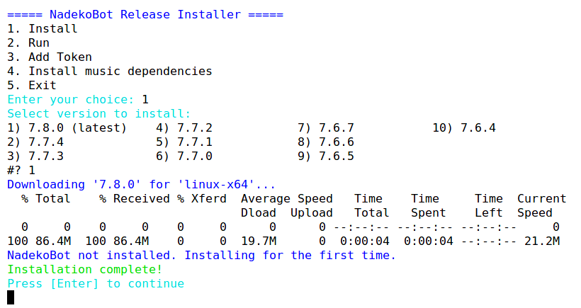

# CLI guide (Linux and macOS)

The bash installer downloads NadekoBot, adds your token, installs the music tools and starts the bot. Use it on a Linux server or on your own Linux or macOS computer.

## Before you start

The installer works on these 64-bit systems:

--8<-- "md/snippets/supported-platforms.md:linux"
--8<-- "md/snippets/supported-platforms.md:macos"

You also need:

- [Create a Discord bot](../creds-guide.md) and copy its token.
- To keep the bot online all day, [get a Linux server](linux-server.md).
- Install `curl`. Most systems already have it.

    /// tab | Ubuntu, Debian, Mint

    ```sh
    sudo apt install curl
    ```

    ///
    /// tab | Fedora, Rocky, Alma

    ```sh
    sudo dnf install curl
    ```

    ///
    /// tab | openSUSE

    ```sh
    sudo zypper install curl
    ```

    ///
    /// tab | Arch, Artix

    ```sh
    sudo pacman -S curl
    ```

    ///
    /// tab | macOS

    Install [Homebrew](https://brew.sh/), then:

    ```sh
    brew install curl
    ```

    ///

## Install the bot

1. Go to your home folder, then download and start the installer:

    ```sh
    cd ~
    curl -L -o n-install.sh https://raw.githubusercontent.com/nadeko-bot/bash-installer/refs/heads/v6/n-install.sh
    bash n-install.sh
    ```

    

2. Type `1` (**Install**) and press ++enter++.
3. Type `1` to select the latest version and press ++enter++. The installer puts the bot in the `nadeko` folder.

    

4. Press ++enter++ to go back to the menu.
5. Type `3` (**Add Token**), paste your token and press ++enter++. In most Linux terminals, paste with ++ctrl+shift+v++.
6. For music, type `4` (**Install music dependencies**) and press ++enter++. Type `y` at each question. The installer installs ffmpeg and yt-dlp. It also installs Deno if your system has no JavaScript runtime.
7. Type `2` (**Run**) and press ++enter++. The bot comes online in your server.

The bot stops when you close the terminal. To keep it running, do the steps in the next section.

Your token, owner IDs and API keys are in `nadeko/data/creds.yml`. To edit the file, type `nano nadeko/data/creds.yml`. To save and exit nano, press ++ctrl+x++, then ++y++, then ++enter++. Restart the bot after you edit the file.

## Keep the bot running

/// tab | tmux (Linux and macOS)

tmux keeps the bot running after you close the terminal.

1. Stop the bot if it runs: press ++ctrl+c++.
2. Start a tmux session:

    ```sh
    tmux new -s nadeko
    ```

3. Type `bash n-install.sh`, then type `2` (**Run**).
4. Press ++ctrl+b++, then ++d++. The bot continues to run in the background.

To go back to the bot, type `tmux a -t nadeko`.

///
/// tab | systemd (Linux)

systemd starts the bot when the server starts and restarts it after a crash. The `.die` command stops the bot.

1. Stop the bot if it runs: press ++ctrl+c++.
2. In your home folder, create the service:

    ```sh
    cd ~
    sudo tee /etc/systemd/system/nadeko.service > /dev/null <<EOF
    [Unit]
    Description=NadekoBot
    After=network-online.target
    Wants=network-online.target
    StartLimitIntervalSec=120
    StartLimitBurst=3

    [Service]
    User=$USER
    WorkingDirectory=$PWD/nadeko
    Environment=PATH=$HOME/.local/bin:$HOME/.deno/bin:/usr/local/bin:/usr/bin:/bin
    ExecStartPre=-$HOME/.local/bin/yt-dlp -U
    ExecStart=$PWD/nadeko/NadekoBot
    Restart=on-failure
    RestartSec=10

    [Install]
    WantedBy=multi-user.target
    EOF
    ```

3. Start the bot now and at each boot:

    ```sh
    sudo systemctl daemon-reload
    sudo systemctl enable --now nadeko
    ```

| Task | Command |
|---|---|
| Stop the bot | `sudo systemctl stop nadeko` |
| Start the bot | `sudo systemctl start nadeko` |
| Show the bot's log | `journalctl -u nadeko -f` |

///

## Update the bot

1. Stop the bot. With systemd, type `sudo systemctl stop nadeko`. In other cases, type `.die` in Discord.
2. Go to your home folder, then download and start the installer again:

    ```sh
    cd ~
    curl -L -o n-install.sh https://raw.githubusercontent.com/nadeko-bot/bash-installer/refs/heads/v6/n-install.sh
    bash n-install.sh
    ```

3. Type `1` (**Install**), select the newest version, then type `y`.
4. Start the bot again. With systemd, type `sudo systemctl start nadeko`. In other cases, type `2` (**Run**) in the installer.

The installer keeps your `data` folder. It also puts a copy of the old `data` folder in `nadeko_backups`.
