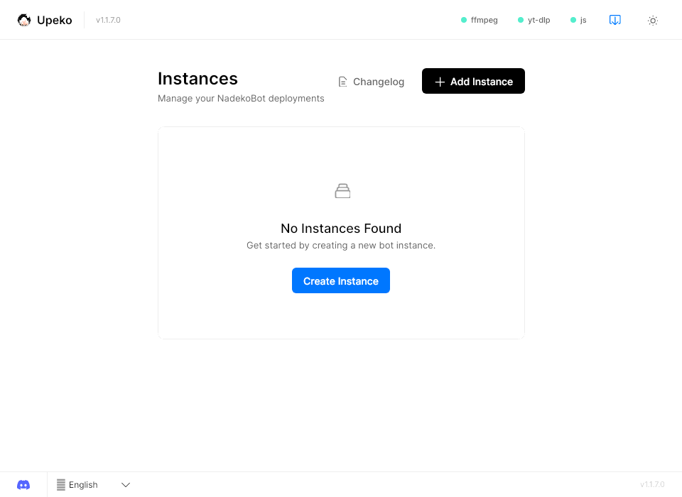
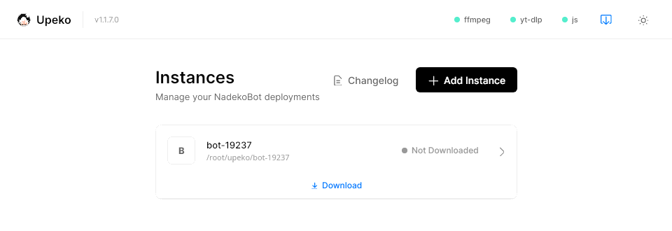
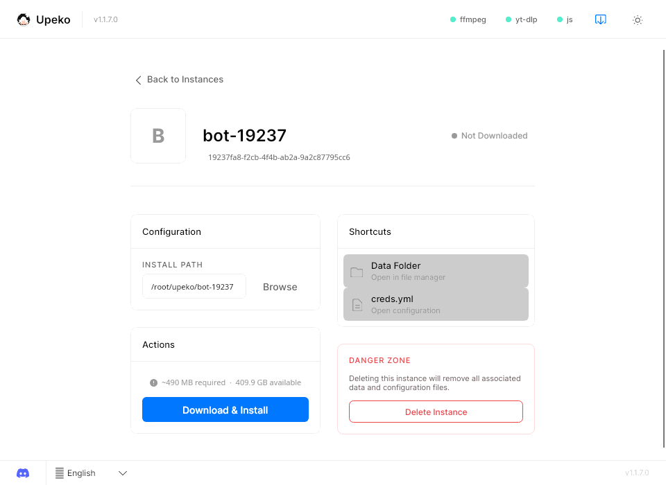
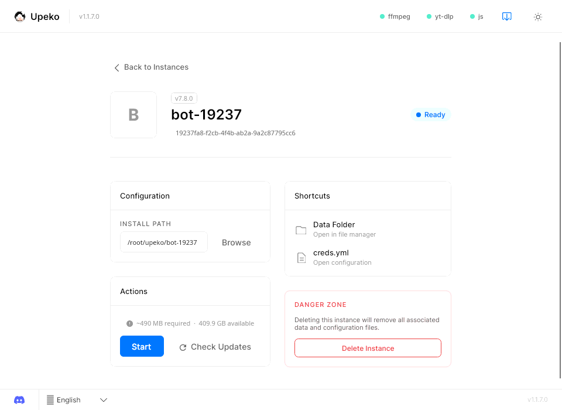
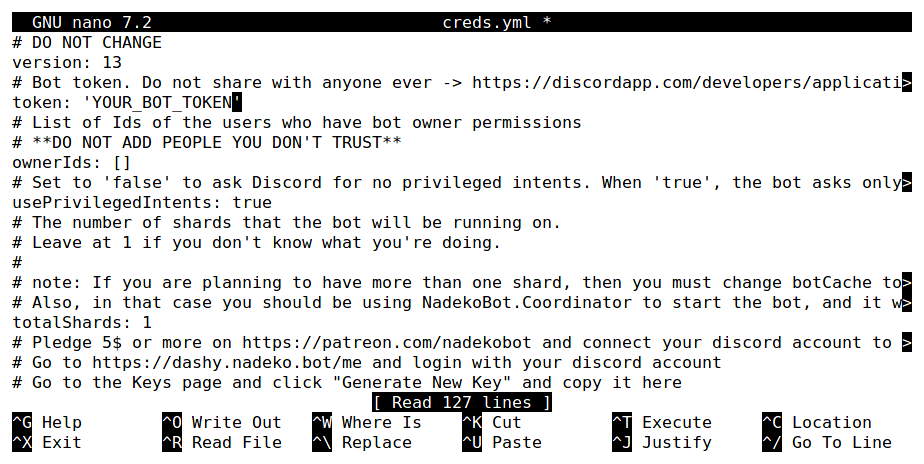

# Desktop guide (Upeko)

Upeko is a desktop app which installs, starts and updates NadekoBot. Use it on your own computer. The bot is online only while Upeko runs.

## Before you start

- [Create a Discord bot](../creds-guide.md) and copy its token.
- Use one of these systems (64-bit):

--8<-- "md/snippets/supported-platforms.md"

## Install the bot

1. Download Upeko from the [latest release](https://github.com/nadeko-bot/upeko/releases/latest):

    | System | File |
    |---|---|
    | Windows | `upeko-win-x64.exe` (`upeko-win-arm64.exe` on ARM) |
    | macOS | `upeko-osx-arm64.app.zip` (Apple chip) or `upeko-osx-x64.app.zip` (Intel) |
    | Linux | `upeko-linux-x64` (`upeko-linux-arm64` on ARM) |

    On Linux, make the file executable before you start it: `chmod +x upeko-linux-x64`.

2. Start Upeko and click **Create Instance**.

    

3. For music, look at the three tools at the top: **ffmpeg**, **yt-dlp** and **js** (Deno). A red dot means that the tool is missing.
4. Click the name of each missing tool to install it. The dot becomes green.

    !!! note "Linux"
        If the ffmpeg dot stays red, install ffmpeg with your package manager, for example `sudo apt install ffmpeg`. Then start Upeko again.

5. Click the new bot to open its page.

    

6. Click **Download & Install**. The download is about 90 MB. The installed bot needs about 490 MB of disk space.

    

7. When the status is **Ready**, click **creds.yml** in **Shortcuts**. The file opens in your text editor. If no app opens, click **Data Folder** and open `creds.yml` with a text editor.

    

8. Put your token between the quotes of the `token` field, then save the file.

    

## Start the bot

Click **Start**. The bot comes online in your server after a few seconds.

**Data Folder** in **Shortcuts** opens the bot's `data` folder, which has the database and the config files.

## Update the bot

1. If the bot runs, click **Stop Instance**.
2. Click **Check Updates** on the bot page.
3. If a new version is available, click **Update**. Upeko installs the new version and keeps your `data` folder.
4. Click **Start**.

If the update fails, close each program that has a bot file open, then try again.

## Next step

To keep the bot online all day, use the [CLI guide](cli-guide.md) or the [Docker guide](docker-guide.md) on a [Linux server](linux-server.md).
